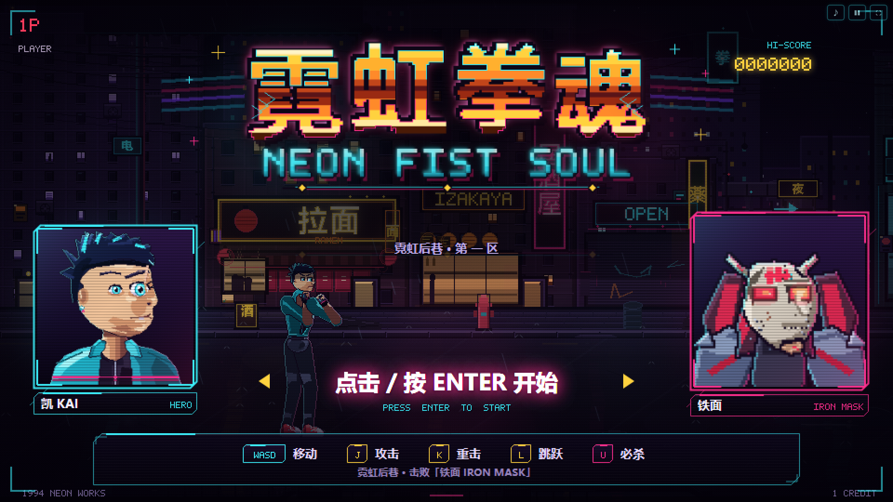
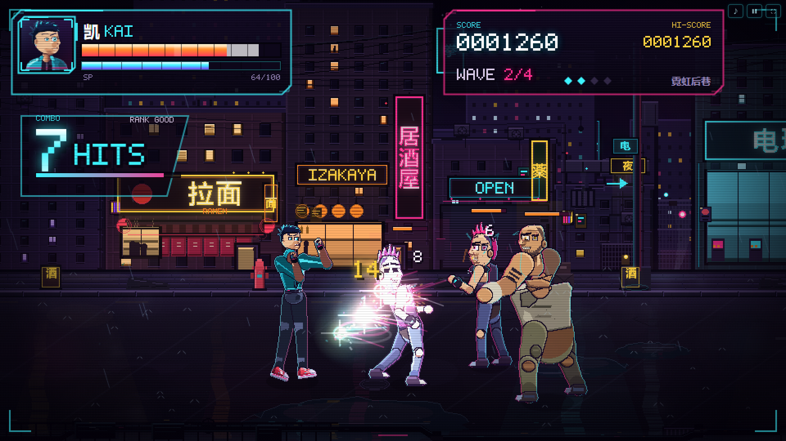
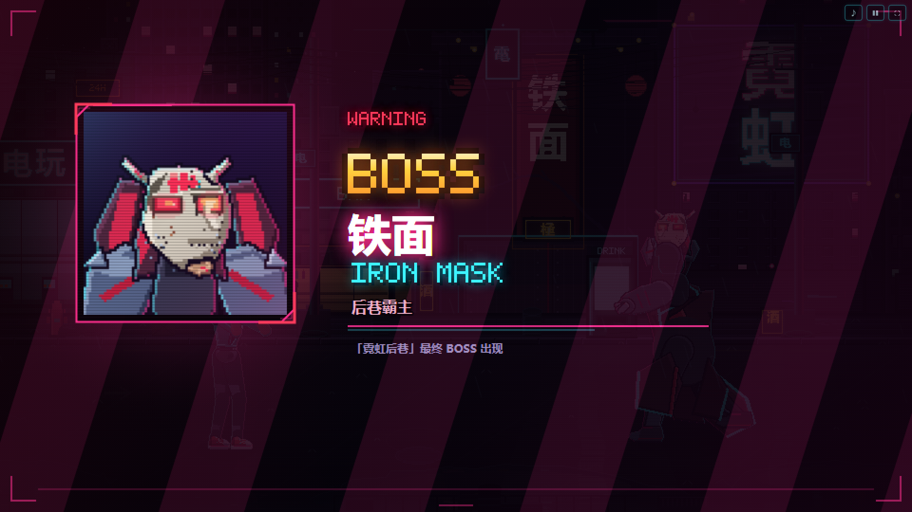
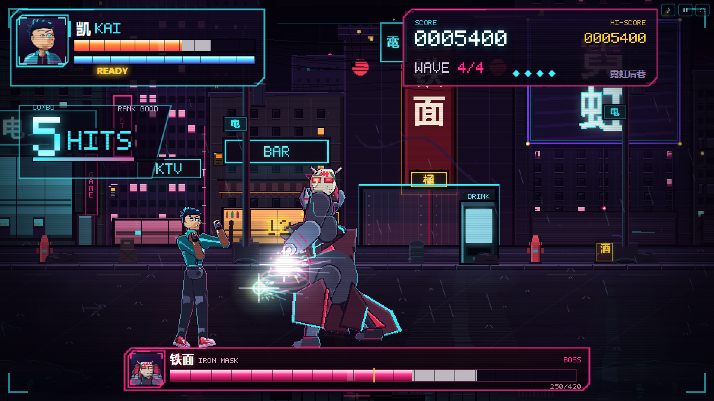
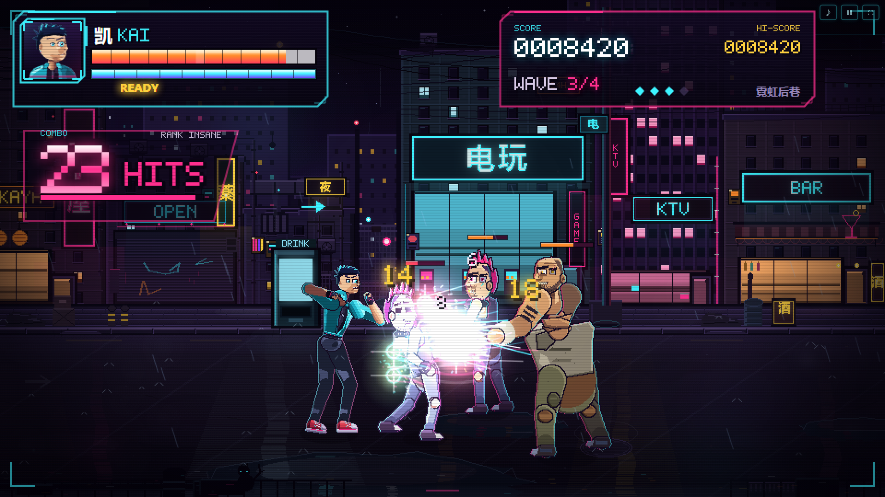
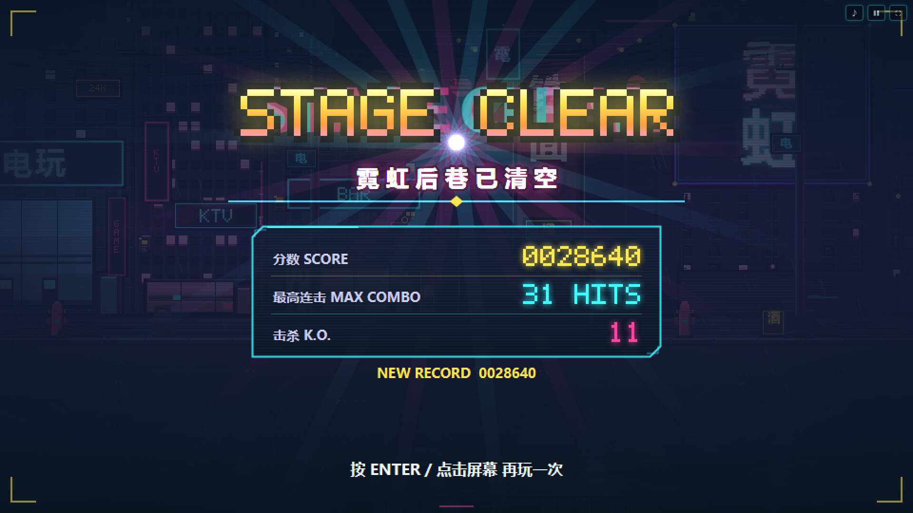
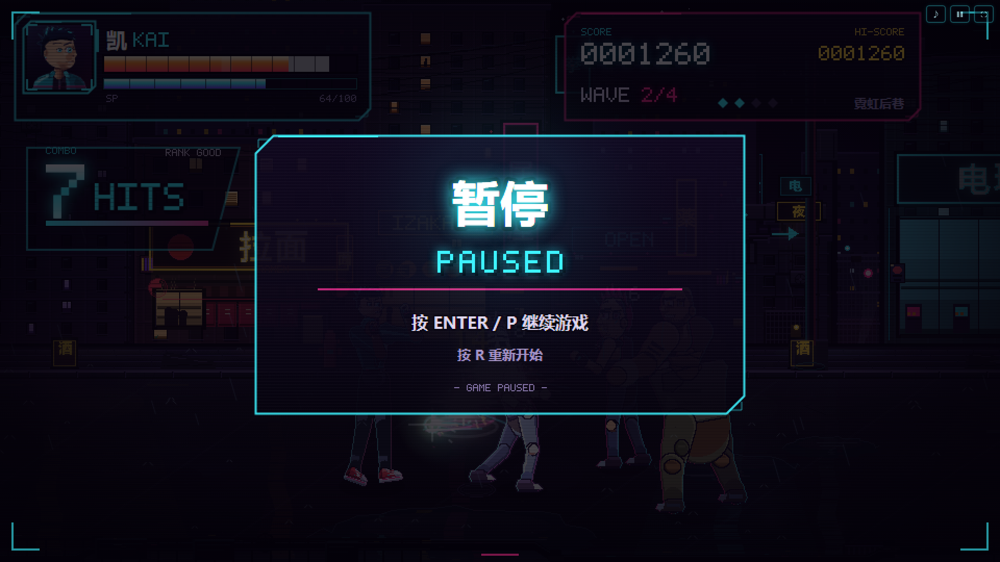
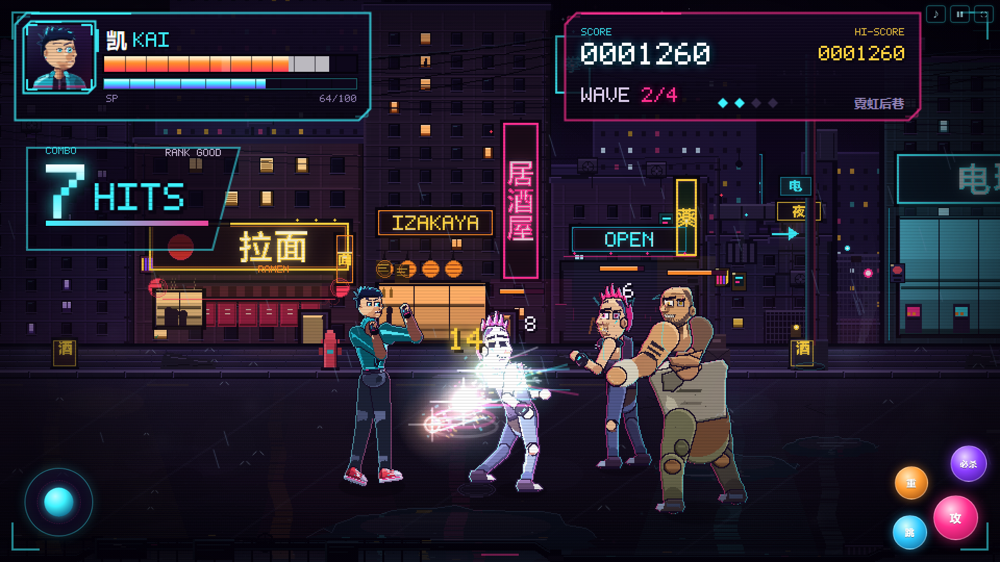

# 霓虹拳魂 NEON FIST SOUL

赛博霓虹夜巷里的横板像素街机清版动作游戏。纯 HTML5 Canvas 实现，**无需安装、无需构建、无需联网**——双击 `index.html` 即可开打。



## 快速开始

- **直接双击 `index.html`**（Chrome / Edge / Firefox 桌面版均可）。
- 首次点击或按键后音频解锁，随后播放芯片音乐与打击音效。
- 手机/平板：横屏打开，自动出现虚拟摇杆和「攻 / 重 / 跳 / 必杀」按钮；点右上角 `⛶` 全屏体验最佳。
- 可选：用本地服务器打开（某些浏览器对 file:// 限制更严时）：
  ```powershell
  python -m http.server 8123
  # 浏览器打开 http://127.0.0.1:8123
  ```

## 操作

| 动作 | 键盘 |
| --- | --- |
| 移动（含纵深走位） | `WASD` / 方向键 |
| 攻击（三段连击） | `J` / `Z` |
| 重击 | `K` / `X` |
| 跳跃（可空中攻击） | `L` / `空格` |
| 必杀「霓虹爆裂」（气槽满） | `U` / `I` / `C` |
| 开始 / 确认 | `Enter` |
| 暂停 | `Esc` / `P` |
| 暂停中重新开始 | `R` |
| 静音 | `M` / 右上角 `♪` |

触屏：左下虚拟摇杆移动，右下四键分别对应 攻 / 重 / 跳 / 必杀。

## 玩法

- **三段连击**：刺拳 → 直拳 → 上勾拳（第三段击飞），可接重击收尾；支持输入缓冲与连段取消。
- **2.5D 清版**：横向推进 + 纵深走位，按脚底位置排序遮挡，跳跃/击飞有真实 Z 轴。
- **必杀「霓虹爆裂」**：命中积攒气槽，满槽释放 5 段判定 + 全屏霓虹闪光 + 慢镜。
- **敌人**：混混（快、匕首）、壮汉（高血高伤重拳）、Boss「铁面」（横扫/冲拳、血量 50% 进入狂暴二阶段、锁镜 Boss 战）。
- **波次推进**：4 波敌人逐步推进，清场后继续向前；后巷尽头迎战 Boss。
- **连击 & 结算**：连击数越高得分越高；KO 有概率掉落血包（+20HP）；HP 归零 K.O.，击败 Boss 通关 STAGE CLEAR。
- **街机细节**：命中停顿、震屏、闪白/红屏、火花与伤害数字、KO 慢镜、雨夜霓虹、湿地面反光、Boss 登场卡。



## 技术说明

- 逻辑分辨率 `960×540`，CSS 像素化放大，`image-rendering: pixelated`；所有坐标按像素网格精确绘制。
- 纯原生 JavaScript（普通 `<script>` 加载、非 ES Module），因此 **file:// 双击可直接运行**；无第三方依赖、无构建步骤、无网络请求。
- 角色为逐帧像素精灵表（主角 54 帧 / 敌人 75 帧），2.5D 纵深按 `y` 排序绘制；主角 186px、Boss 250px 高。
- 所有美术资源由 `tools/gen_*.py`（Python + Pillow）程序化绘制、烘焙，可复跑；无外部图片/字体素材。
- 音频为 WebAudio 程序化合成（芯片音乐 + 打击/环境音效），无音频文件；浏览器首次手势解锁。
- 四层视差背景（远景 1600×540 无缝平铺、中景 3200×540、近景街面、前景剪影）+ 雨/霓虹/粒子特效。
- 帧循环固定相机跟随 + 震屏，HUD/菜单独立于世界坐标绘制。

## 目录结构

```
index.html            入口（双击即玩）
styles.css            页面与触控 UI
src/
  config.js           分辨率/关卡/调参
  utils.js            工具函数
  assets.js           资源注册与加载
  input.js            键盘/触屏/手柄输入
  camera.js           相机跟随/震屏/锁定
  render.js           精灵渲染器
  stage.js            四层视差舞台
  audio.js            WebAudio 音乐与音效
  fx.js               粒子/震屏/闪屏/伤害数字
  hud.js              HUD/标题/暂停/结算/Boss登场
  player.js           凯的移动/连招/必杀
  enemies.js          敌人 AI 与 Boss
  game.js             状态机/波次/计分/调试场景
  main.js             启动、主循环、截图调试
assets/
  chars/hero/         主角精灵表 + 头像 + manifest
  chars/enemies/      混混/壮汉/铁面 精灵表 + 头像 + manifest
  world/              四层视差背景 + manifest
  ui/                 标题 Logo
tools/
  gen_hero.py         主角美术生成器（可复跑）
  gen_enemies.py      敌人美术生成器（可复跑）
  gen_world.py        场景/UI 美术生成器（可复跑）
  verify_assets.py    资源完整性校验
  shot.ps1            无头 Chrome 截图工具（开发用）
  cdp_smoke.mjs       CDP 冒烟测试（加载/操作/暂停/音频/各场景）
  cdp_selftest.mjs    玩法自检机器人（完整通关/失败流程）
```

## 开发调试参数

URL 追加参数：

- `?shot=title|battle|boss|combo|intro|victory|gameover`：直接进入对应展示场景。
- `&freeze=0.2`：截图场景模拟时长（秒）。
- `&touch=1`：强制显示触屏控件；`&mute=1` 静音启动；`&debug=1` 输出调试信息。
- `?selftest=1&mode=victory|gameover`：无头机器人自动跑完整流程（结果写入 `window.__NF_SELFTEST` / document.title）。

开发截图（需本地服务器 `python -m http.server 8123`）：

```powershell
& .\tools\shot.ps1 -Name battle -Query "?shot=battle&freeze=0.2"
node tools/cdp_smoke.mjs          # 17 项冒烟测试
node tools/cdp_selftest.mjs victory
python tools/verify_assets.py     # 资源完整性
```

## 验收画面

| | |
| --- | --- |
|  |  |
|  |  |
|  |  |

## 素材与版权

- 角色、场景、UI、音乐、音效全部为本项目程序化生成，无第三方素材。
- 中文 UI 使用系统字体（Microsoft YaHei / PingFang SC），数字与英文使用自绘 5×7 像素字体。

---

**霓虹后巷，今晚只留一个人站着。**
